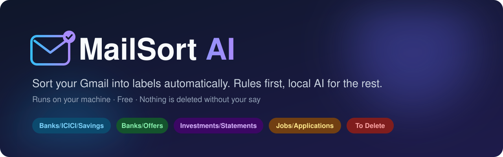

<p align="center">
  
</p>

<p align="center">
  
  
  
  
  
  
</p>

**MailSort AI** sorts your Gmail into tidy labels. Bank statements are filed per bank and account type, offers and alerts get their own labels, real job applications are kept apart from job-board spam, and promotions are queued up for deletion. It runs on your own machine with your own Google credentials, and you preview every change before anything is applied.

## How it sorts

| Label | What goes there |
|-------|-----------------|
| `Banks/<Bank>/Savings` | Savings and account statements, one folder per bank (ICICI, AU, HDFC, Axis, Kotak, SBI, IndusInd, YES, IDFC FIRST, Standard Chartered, ...) |
| `Banks/<Bank>/Credit Card` | Credit card statements per bank (including OneCard and Scapia) |
| `Banks/Alerts` | Transaction alerts, bill reminders and card payment reminders |
| `Banks/Offers` | Bank marketing: loans, card upgrades, pre-approved offers |
| `Banks/Other/Statements` | Statements from banks not in the list |
| `Investments/Statements` | CDSL/NSDL, CAMS/KFintech, mutual fund and broker statements |
| `Jobs/Applications` | Real application updates from company career sites and applicant tracking systems (Workday, Greenhouse, Lever, ...) |
| `Jobs/Alerts` | Job-board mail: Naukri, LinkedIn, Indeed, Glassdoor, foundit, Instahyre, ... |
| `To Delete` | Promotions, newsletters and ads. **They are only labelled, never deleted**, so you review and delete them yourself. |

Important mail is **never touched**: security alerts, OTPs, password resets, orders and deliveries, invoices, payslips, bookings and so on stay exactly where they are.

### Rules first, AI second

1. **Rules** handle most mail (about 90% in testing), using sender domains and subject patterns. They are fast and predictable.
2. **AI (optional)** looks at only what the rules can't place: sender, subject and a short snippet. It runs on a local [Ollama](https://ollama.com) model, so nothing leaves your machine. If it isn't sure, it leaves the email alone.
3. **Preview** shows the count per label, the top senders and sample emails, each tagged *rule* or *AI*. Untick any label you don't want.
4. **Apply** creates the labels in Gmail and adds them. You can also choose to move the emails out of your Inbox.

Emails that are already sorted are skipped on later runs, so running it again only processes new mail. You can scan **all mail** or a **date range**.

## Also included

These features come from the original [Gmail Cleaner](https://github.com/Gururagavendra/gmail-cleaner) and still work:

- **Bulk Unsubscribe**: find newsletters and unsubscribe in one click
- **Delete by Sender**: see who sends the most mail and delete in bulk (to Trash, which you can recover from)
- **Mark as Read / Archive / Mark Important** for selected senders
- **Label management** and **CSV export** of email metadata
- **Filters** by date, size, category, sender and label

## Quick start

### 1. Create your own Google OAuth credentials

The app doesn't ship with shared credentials. You use your own, so only you have access to your mailbox.

1. Open [Google Cloud Console](https://console.cloud.google.com/) and create a project.
2. Search for **Gmail API** and click **Enable**.
3. Go to **Google Auth Platform** → **Get started**: enter an app name, choose **External**, add your email, then click **Create**.
4. Go to **Audience** → **Test users** → **Add Users** and add your Gmail address.
5. Go to **Clients** → **Create Client** and pick the type for your setup:

   | Setup | Application type | Redirect URI |
   |-------|------------------|--------------|
   | Docker | Web application | `http://localhost:8767/` |
   | Python (local) | Desktop app | not needed |

6. Download the JSON file, rename it to `credentials.json`, and put it in the project folder.

### 2. Clone the repo

```bash
git clone https://github.com/sdhanush13/mailsort-ai.git
cd mailsort-ai
```

### 3. (Optional) Set up local AI

Install [Ollama](https://ollama.com/download), then pull a small model:

```bash
ollama pull qwen2.5:3b
```

Uncomment the `LLM_*` lines in `docker-compose.yml`. Without them the app runs in rules-only mode, which still sorts most mail.

| Variable | Default | Purpose |
|----------|---------|---------|
| `LLM_BASE_URL` | *(empty, so AI is off)* | Any OpenAI-compatible endpoint, for example `http://host.docker.internal:11434/v1` for Ollama |
| `LLM_MODEL` | `qwen2.5:3b` | Model name |
| `LLM_API_KEY` | *(empty)* | Only needed for hosted APIs such as Groq |
| `LLM_TIMEOUT` | `60` | Seconds per request |

> **Which model?** `qwen2.5:3b` (about 2 GB) runs well on a 4 GB GPU at roughly 3–4 seconds per email. With 8 GB of VRAM or more, `qwen2.5:7b` is more accurate. A hosted API such as Groq is much faster, but email subjects and snippets are then sent to that provider.

### 4. Run it

**Docker (recommended)**

```bash
docker compose up --build
```

Open http://localhost:8766 and click **Sign In**. Then get the Google sign-in link from the logs:

```bash
docker compose logs
```

Open the `https://accounts.google.com/...` link and approve access. Google will say it "hasn't verified this app"; that's expected for your own credentials, so click **Continue**. Your sign-in is saved to `./data/token.json`, so you only need to do this once.

**Python (with [uv](https://docs.astral.sh/uv/))**

```bash
uv sync
uv run python main.py
```

### 5. Organize

Open **Auto-Organize** in the sidebar, choose **All mail** or a **Date range**, and click **Preview**. Check the results, untick anything you don't want, and click **Apply**.

## Privacy

- **Runs locally.** No servers of ours and no tracking. The only outside service the app talks to is Gmail.
- **Your own credentials.** You create the OAuth app, so you can revoke access at any time.
- **Local AI.** With Ollama, email text never leaves your computer.
- **Secrets stay out of git.** `credentials.json` and `token.json` are gitignored.

## Troubleshooting

| Problem | Fix |
|---------|-----|
| *Access blocked: app has not completed verification* | Add your Gmail address as a **Test user** (step 1.4). |
| *Error 403: access_denied* | Use your own credentials, check you're a test user, and make sure `credentials.json` is in the project folder. |
| *mismatching_state / CSRF* | Run `docker compose down`, delete `./data/token.json`, then sign in again in a private browser window. |
| *Invalid Redirect* | Google doesn't allow IP addresses in redirect URIs. Use `localhost` or a domain name (a free DuckDNS domain works). |
| *Quota exceeded* | Gmail allows a limited number of requests per minute. The app slows down and retries on its own, so just let it run. |
| *AI unavailable* | Check Ollama is running (`ollama list`) and that `LLM_BASE_URL` uses `host.docker.internal`, not `localhost`, when running in Docker. |
| *Can't delete files in `./data`* | Docker creates them as root. Run `sudo chown -R $USER:$USER ./data`. |

For custom ports, custom domains or reverse proxies, see the `OAUTH_HOST` and `OAUTH_EXTERNAL_PORT` options in `docker-compose.yml`.

## Development

```bash
uv sync
uv run pytest
```

The sorting code lives in `app/services/gmail/`:

- `organize_rules.py`: bank, job and promotion rules (add a new bank here)
- `llm.py`: the AI fallback
- `organize.py`: the preview and apply flow

## Credits

MailSort AI is built on [Gmail Cleaner](https://github.com/Gururagavendra/gmail-cleaner) by [Gururagavendra](https://github.com/Gururagavendra), released under the MIT License. The original unsubscribe, delete and cleanup features are their work.

## License

[MIT](LICENSE)
